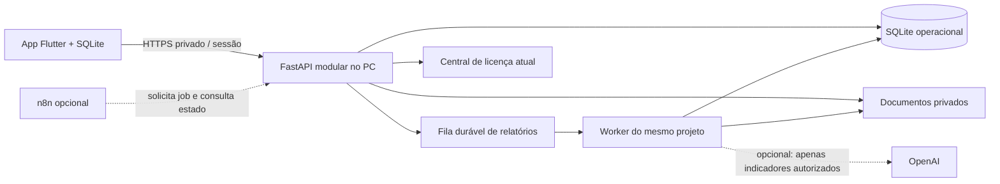

# AgroGestor v2 — produto, dados e implementação

Proposta de 14/10/2026. Público confirmado: produtores com várias propriedades e prestadores que atendem vários produtores. Culturas: café e lavouras de grãos. Piloto confirmado no PC gestor e na rede privada atuais. Quantidade de clientes/usuários e orçamento ainda desconhecidos. Os cenários de custo abaixo são hipóteses de planejamento.

## Foco operacional confirmado

O centro do produto é **frota, insumos, consumo, talhões e operações**. A primeira entrega prioriza vincular a operação ao cliente/imóvel/talhão, apropriar horas de máquina e baixar insumos com rastreabilidade. O financeiro completo, vendas e produtividade comercial continuam como expansão; não transformar o piloto em um ERP genérico.

O primeiro recorte 1A será uma API piloto de operações e consumo: cadastros relacionais essenciais, máquinas atribuídas à propriedade, estoque inicial/entradas explícitos, consumo transacional e relatórios de horas, área de passadas e custos conhecidos de máquina/insumos. Mão de obra, depreciação completa, produção e resultado de safra não estarão incluídos no total operacional inicial. PDF/Excel e interface v2 serão entregas posteriores, sem anunciar conclusão antecipada.

## 1. Diagnóstico comprovado no código

Base examinada: `2026-10-07/te/outputs/agrogestao`, versão Flutter 1.0.1+2002.

| Área | O que existe | Limite observado |
|---|---|---|
| App | Flutter/Dart; telas por funcionalidade; navegação e regras por perfil | Somente os perfis legados administrador, operador e mecânico; o rótulo “Administrador / Proprietário” não constitui duas permissões diferentes |
| Clientes e imóveis | `RuralClient` contém `RuralProperty`, que contém `RuralField`; existem formulários de cliente, propriedade e talhão | Relações aninhadas em JSON; cultura é texto do talhão; sem ciclo/safra normalizado |
| Operações | Serviços, máquina, operador, cliente, propriedade, nome do talhão, área, data, horímetro e observações | Serviço não é uma ordem agrícola completa de plantio/aplicação/colheita; talhão ainda é referência textual |
| Insumos | Produto com quantidade/unidade/lote e registros de consumo; uso pode estar ligado ao serviço | Não há razão completo de entradas, saídas, compras, ajustes, transferências, reservas e custo médio |
| Frota | Máquinas, implementos, abastecimento e manutenção | Horas e custos parciais; não há custo completo por atividade com depreciação/rateio |
| Pessoas | Contas de acesso e cadastro de operadores | Conta, funcionário e prestador não são a mesma entidade; não há apropriação completa de mão de obra |
| Relatórios | Horas, serviços, combustível, manutenção e PDF no próprio app; filtros mês/ano/tudo | Sem Excel, safra, financeiro por competência/caixa, custo agrícola completo ou produtividade comercial. Horas ausentes entram como zero no resumo atual e áreas ausentes têm valores padrão em alguns modelos; isso não será usado como verdade no v2 |
| App offline | SQLite com JSON, fila e conflitos por registro para conta conectada; preferências no modo legado | Não existe ainda protocolo offline para as novas tabelas relacionais |
| Servidor operacional | Python/FastAPI, SQLite, API privada no PC; autenticação, convites, anexos e sincronização | Uma organização/fazenda configurada por instalação. O banco central de licenças não armazena dados operacionais |
| Licença | Central Windows separada ou alternativa Firebase | Não é servidor de relatórios; não deve receber automaticamente dados agrícolas |
| Hospedagem | Scripts locais e configuração para Tailscale/HTTPS privado | Não foi identificada implantação SaaS pública. Configuração existente não comprova disponibilidade de um serviço em execução |
| IA/automação | Não localizadas integrações operacionais com OpenAI ou n8n | Serão opcionais; relatórios básicos não dependerão delas |

Evidências principais: `lib/features/clients/client_record.dart`, `services/farm_service.dart`, `products/product_record.dart`, `reports/reports_screen.dart`, `auth/user_model.dart`, `sync/`, `server/agrogestor_server/app.py` e `central_license/`.

## 2. Perguntas ainda essenciais

Respondidas: ambos os públicos; café e grãos; manter PC e rede privada no piloto.

Pendentes, sem impedir a fundação técnica: quais grãos; forma e umidade de comercialização do café; pesos de saca usados em cada produto; quantidade de assinantes, propriedades e usuários; simultaneidade; quem registra despesas; quem aprova ajustes; quais custos indiretos entram no resultado; método de avaliação de estoque; envio por e-mail/WhatsApp e autorização dos destinatários; prazo de retenção; responsabilidade por operação e backups; orçamento; necessidade futura de pecuária.

Não converter automaticamente “café” em café beneficiado nem considerar toda saca como 60 kg. Não implementar recomendações agronômicas ou pecuária sem confirmar necessidade e responsabilidade técnica.

## 3. Prioridade por valor e esforço

| Prioridade | Entrega | Valor | Esforço relativo | Dependência/critério de conclusão |
|---|---|---|---|---|
| P0 | Isolamento, permissões por propriedade, auditoria e migração reversível | Muito alto | Médio | Testes negando acesso cruzado, preservação do legado e restauração |
| P0 | Organização → cliente → propriedade → talhão → ciclo/cultura | Muito alto | Médio | Chaves e vínculos validados no servidor; erros de referência recusados |
| P0 | Custos/receitas, produção e caixa com valores desconhecidos explícitos | Muito alto | Médio | Dinheiro em centavos; produção decimal; competência separada de pagamento |
| P0 | Relatórios essenciais com origem de cada valor e qualidade dos dados | Muito alto | Médio | Fórmulas reproduzíveis, sem transformar ausência em zero |
| P1 | Fluxo móvel de safra e lançamento rápido | Muito alto | Médio | Funciona com a API real, validações e mensagens de erro; tela isolada não encerra a entrega |
| P1 | Offline v2 e conflitos/estornos de lançamentos | Alto | Alto | Reenvio idempotente, nenhuma duplicação ou perda em dois aparelhos |
| P1 | PDF e Excel com as mesmas linhas e totais | Alto | Médio | Totais conferidos; filtros/data/identificação; sem fórmulas executáveis vindas de texto |
| P1 | Estoque por movimento e apropriação de máquinas/mão de obra | Alto | Alto | Sem dupla contagem, custo histórico e trilha de correções |
| P2 | Planejamento, comparação e orçamento por safra | Alto | Médio | Base e realizado separados, comparação com unidades e escopo equivalentes |
| P2 | Agendamento de relatórios, notificações e n8n | Médio | Médio | Fila durável, repetição segura, falha visível e destinatários autorizados |
| P2 | Explicação por IA | Médio | Médio | Texto referencia indicadores calculados; não altera valores; avaliação contra alucinações |
| Futuro | Pecuária, geometrias/mapas, integrações fiscais/bancárias | A confirmar | Alto | Pesquisa com usuários e escopo próprio |

## 4. Modelo de dados proposto

“Organização” é a conta contratante do AgroGestor. “Cliente rural” é o produtor atendido ou o cadastro do próprio produtor. “Propriedade” é um imóvel/unidade operacional. O `farmId` atual continuará identificando a organização do servidor legado; não será reinterpretado como o identificador de cada imóvel.

```mermaid
erDiagram
  ORGANIZACAO ||--o{ CLIENTE_RURAL : atende
  CLIENTE_RURAL ||--o{ PROPRIEDADE : possui_ou_explora
  PROPRIEDADE ||--o{ TALHAO : contem
  TALHAO ||--o{ CICLO_SAFRA : recebe
  CULTURA ||--o{ CICLO_SAFRA : identifica
  CICLO_SAFRA ||--o{ OPERACAO : registra
  OPERACAO ||--o{ CONSUMO_INSUMO : utiliza
  OPERACAO ||--o{ USO_MAQUINA : apropria
  OPERACAO ||--o{ HORA_PESSOA : apropria
  CICLO_SAFRA ||--o{ LANCAMENTO : apura
  CICLO_SAFRA ||--o{ PRODUCAO : produz
  ORGANIZACAO ||--o{ VINCULO_ACESSO : autoriza
  PROPRIEDADE ||--o{ VINCULO_ACESSO : restringe
```

Todas as entidades pertencem a uma organização; chaves estrangeiras compostas incluem `tenant_id`. O servidor extrai essa organização da sessão autenticada, nunca de um parâmetro confiado ao celular. Um prestador pode atender vários clientes rurais dentro da sua organização; um proprietário convidado só recebe acesso às propriedades explicitamente atribuídas. Isso exige validar tanto a organização quanto a propriedade.

| Entidade | Dados e relacionamentos relevantes |
|---|---|
| Organização/assinante | ID estável, nome, moeda, fuso e configuração de retenção; ligação com licença separada |
| Pessoa/conta e vínculos | Conta autenticada, pessoa/funcionário independente, função por propriedade, vigência e status; prestador/consultor pode ter vários vínculos |
| Cliente rural | Nome/documento/contato mínimos; dados pessoais não são enviados à IA |
| Propriedade | Cliente, nome, município/localização, área total conhecida ou desconhecida, responsáveis |
| Talhão | Propriedade, nome, área mensurada ou desconhecida, histórico de alteração; geometria opcional futura |
| Cultura | Nome/código; café/grão; formas de produção e conversões autorizadas |
| Ciclo/safra | Talhão, cultura, identificação (2026/27, safra/safrinha), datas, área cultivada histórica, forma do produto; lavoura de café pode manter o talhão por vários ciclos |
| Operação/atividade | Tipo (plantio, aplicação, manejo, colheita), ciclo, datas, área trabalhada, responsável, estado, observações e evidências |
| Fornecedor | Identificação/contatos; vínculo com compras e documentos |
| Insumo/lote | Produto, unidade base, lote, validade quando aplicável, fornecedor, entradas e custo histórico |
| Movimento de estoque | Entrada, saída, consumo, devolução, ajuste ou transferência; quantidade, unidade, custo, origem e autor; estorno preserva o movimento original |
| Máquina/implemento e uso | Máquina, operação, horas/horímetro, taxa de custo vigente, componentes incluídos e comprovação; evitar somar combustível novamente se já está na taxa |
| Pessoa e apropriação | Funcionário/prestador, operação, horas, valor histórico/hora e encargos considerados |
| Produção/perda | Colheita bruta, perda, produção líquida, unidade, forma do café/grão e fator de conversão documentado; nenhuma mistura de café cereja e beneficiado |
| Venda/receita e recebimento | Produto, quantidade, competência, preço, receita e descontos; recebimento com data de caixa vinculado à venda |
| Despesa/custo e pagamento | Valor conhecido ou pendente, categoria, competência, vencimento, custo apropriado ao ciclo e pagamento separado |
| Alocação/rateio | Despesa de origem, base de rateio declarada, parcelas e reconciliação; alocações não podem exceder o original |
| Planejamento | Versão do orçamento por ciclo/atividade, quantidades, preços e área previstos; não sobrescrever o orçamento aprovado |
| Auditoria | Autor, organização, propriedade, entidade, antes/depois, versão, data UTC e justificativa |
| Relatório/job/documento | Filtros, permissões, período, versão das fórmulas, instante do retrato, origem dos registros, estado do job, hash do arquivo, prazo e compartilhamento |

Dinheiro: centavos inteiros em BRL no piloto. Quantidades e áreas: Decimal com unidade explícita, até seis casas decimais; não usar ponto flutuante para apuração monetária. IDs UUID. Instantes em UTC e apresentação em America/Sao_Paulo; competência/pagamento usam datas civis explícitas. Taxas e fatores históricos não mudam quando o cadastro é atualizado.

No café, custos de formação e investimentos precisam de regra de capitalização/amortização definida com o responsável contábil. Não lançar o valor integral da formação como custo de todas as safras. Nos grãos, safra, safrinha e sucessão no mesmo talhão são ciclos distintos. Consórcios e ocupação compartilhada de área exigem rateio explícito e ficam fora do primeiro piloto.

## 5. Indicadores e relatórios

O catálogo detalhado está em `Indicadores-e-relatorio-ficticio.md`. Regras gerais: soma de valores conhecidos gera “subtotal conhecido”; não vira total completo quando há linhas sem valor. Uma lista vazia não prova custo zero. Denominadores ausentes ou iguais a zero impedem divisões. Toda tela mostra unidade, filtros, qualidade e link para os lançamentos que compõem o indicador.

Não chamar resultado operacional parcial de lucro líquido. Margem é uma proporção do resultado sobre a receita. Fluxo de caixa usa datas de recebimento/pagamento e inclui movimentos que não são receita/custo por competência. Comparar ciclos com área única por ciclo, pesos/unidades/formas compatíveis e mesma abrangência de custos; não somar hectares de cada aplicação para calcular custo/ha do ciclo.

PDF e Excel usarão o mesmo retrato calculado pelo servidor, com identificação da propriedade, safra/talhão/cultura, filtros, data/fuso, unidades, fórmulas, linhas de origem e pendências. Excel terá abas Resumo, Lançamentos, Qualidade e Metadados. PDF terá resumo executivo e detalhamento; campos ausentes aparecerão como “Não informado”, nunca zero. Exportação não será considerada pronta até ambos os arquivos reproduzirem os totais da API e forem testados com dados incompletos e volume realista.

## 6. Acesso e privacidade

| Função | Permissão proposta |
|---|---|
| Administrador da organização | Cadastros, vínculos, correções, auditoria e todos os imóveis daquela organização; não acessa outra organização |
| Proprietário | Consulta financeira/operacional e aprovação nas próprias propriedades; gestão financeira mediante permissão explícita; não gerencia a plataforma |
| Gerente | Lançamentos, revisão, estoque e relatórios das propriedades atribuídas; não concede acesso global |
| Funcionário | Lançamento operacional e produção nas propriedades atribuídas; vê os próprios registros necessários ao trabalho; sem relatório financeiro completo ou ajuste de preço |
| Consultor | Consulta dos indicadores e registros autorizados, sem editar lançamentos financeiros ou estoque |

No primeiro recorte, os novos papéis são vínculos por propriedade sem reescrever o CHECK de funções da tabela de contas legada. O administrador legado administra sua organização; os outros usuários não ganham automaticamente papel de gerente ou proprietário. Contas existentes poderão receber novos vínculos de forma explícita.

Toda listagem, detalhe, edição, exportação, relatório e job precisa aplicar a mesma autorização no servidor. Testar IDs de outra organização e de outra propriedade, inclusive referências em corpos de requisição. Resposta 404 para recurso não visível evita confirmar sua existência. Auditoria de despesas/produção/estoque acompanha a transação. Correções têm justificativa e versão, sem edição silenciosa.

Privacidade: mapear controlador/operador e finalidade/base legal; coletar o mínimo de documentos/contatos, definir retenção, canal de direitos, contratos com fornecedores e procedimento de incidente. Retenção e exclusão precisam respeitar obrigações aplicáveis e trilha necessária; não prometer apagar documentos obrigatórios automaticamente. Avaliar transferência internacional antes de enviar dados a serviços externos. Referência normativa: [LGPD, texto oficial](https://www.planalto.gov.br/ccivil_03/_ato2015-2018/2018/lei/l13709.htm). A política do produto deve ser revisada conforme o uso real.

## 7. Arquitetura proporcional e integrações

### Piloto confirmado: PC e rede privada

Manter Flutter + SQLite no celular, um FastAPI modular e SQLite no PC. Adicionar módulos relacionais ao mesmo servidor; manter licença separada logicamente, como hoje. Documentos e relatórios ficam em diretório protegido fora de conteúdo público, acessados por endpoints autenticados. Nenhuma chave OpenAI ou credencial n8n no APK.

Relatórios curtos retornam diretamente. Relatórios grandes viram jobs persistidos: aguardando, preparando, pronto, falhou ou cancelado, com progresso quando mensurável. Worker é um processo do mesmo projeto/PC, não um microserviço independente; reserva jobs com transação, prazo de posse, repetição idempotente e tentativas limitadas. Reavalia acesso na leitura/download; o job não perpetua uma permissão revogada. Primeiro recorte não instala esse worker.

Desenvolvimento usa pasta/banco/segredos próprios com dados fictícios; testes usam diretórios temporários; produção mantém dados reais e artefatos versionados. O piloto v2 fica em uma cópia de fontes separada, sem `.env`, bancos ou chaves reais.

### Crescimento condicionado a necessidade medida

Quando o PC deixar de atender disponibilidade, conexões ou tempo de relatório: manter o monólito modular e mover para uma VM com HTTPS, PostgreSQL e armazenamento de objetos privado. A primeira opção central pode usar API e worker no mesmo host; separar o banco gerenciado quando backup/concorrência justificarem. Sem Kubernetes, múltiplas APIs ou Redis obrigatório na partida.

A migração SQLite → PostgreSQL será projeto testado: cópia, chaves compostas, Decimal, contagens/checksums, isolamento e reconciliação dos relatórios. SQLite não deve ser acessado por compartilhamento de rede. Centralizar vários assinantes exige testar autenticação multi-organização; a instalação atual continua de uma organização por PC e não se torna SaaS só por criar tabelas com `tenant_id`.

### Operação

- Backup com SQLite Backup API e cópia consistente dos anexos, preferencialmente com serviço parado; não copiar só o `.sqlite3` enquanto houver WAL pendente. Guardar segredos em backup separado protegido.
- Meta inicial proposta: RPO de 24 horas e RTO de 4 horas, a validar com o produtor. Retenção sugerida: 7 diários, 4 semanais, 12 mensais, limitada por capacidade e política de dados. Ao menos uma cópia fora do PC e teste mensal de restauração em pasta isolada.
- Antes de migrar: criar backup operacional consistente, conferir hash/integridade, executar ensaio em cópia e registrar versão. Na restauração: parar serviços, validar backup, restaurar banco/anexos/segredos correspondentes, conferir acesso, amostras e relatórios; manter o banco anterior até a aprovação operacional.
- Logs estruturados com ID de requisição/job, sem senhas, tokens, chave de licença ou documento pessoal. Separar log técnico e auditoria de negócio. Monitorar disco, falhas de login/sincronização, idade do backup, latência, fila e falha do worker; alertas sem valores pessoais.
- Segredos por ambiente, permissões de pasta, rotação e acesso mínimo. TLS privado e firewall; uma assinatura Android própria é requisito de distribuição. Observabilidade e alertas têm que ser testados por falha simulada, não apenas configurados.

## 8. OpenAI e n8n: uso justificado

**OpenAI direta no servidor**: resumir indicadores prontos, explicar quais lançamentos mudaram e redigir um comentário solicitado no app. Código/consultas calculam tudo antes. Enviar JSON com IDs de indicadores, valores, unidades, qualidade, comparação e proveniência, sem nomes/documentos. Pedir saída estruturada referenciando IDs, validar o esquema e rejeitar números ou conclusões sem origem; mesmo JSON válido pode conter erro semântico. Falha/timeout da IA não impede consultar números. Sem navegação web ou ferramentas de escrita nesse primeiro uso. [Saídas estruturadas, documentação oficial](https://developers.openai.com/api/docs/guides/structured-outputs).

Exemplo de frase permitida: “O custo registrado por hectare aumentou 8%; a categoria máquinas explica R$ X da variação.” Somente se esses dados estiverem no JSON. Frase agronômica não autorizada: “Aplique determinado produto/dose para recuperar rendimento”. Análise descritiva é separada de hipótese e recomendação técnica; propostas agronômicas exigem contexto, validação profissional e módulo próprio.

**n8n**: faz sentido quando houver rotinas estáveis e integrações externas: agenda → solicita relatório autenticado → acompanha job → notifica destinatário autorizado. A API continua responsável por cálculo, autorização, dados e auditoria. Usar credencial de serviço com escopo restrito, verificação de assinatura/replay em webhooks, chave de idempotência e minimização dos dados salvos nos logs do fluxo. Não dar acesso direto ao banco nem compartilhar a credencial administrativa.

Começar com integração direta para uma explicação no app e agendador/worker do próprio projeto para a primeira rotina. Adotar n8n quando reduzir manutenção de várias integrações o suficiente para justificar atualização, backup de banco/chave de criptografia, controle de acesso e histórico de execuções. Não instalar nem ativar envios nesta etapa.

Na API OpenAI, configurar retenção e `store` conforme a finalidade; desativar armazenamento da resposta não elimina necessariamente logs de monitoramento. A documentação informa que dados da API não são usados para treinamento por padrão e descreve retenções e exceções. Não prometer retenção zero sem elegibilidade/configuração confirmadas. [Controles de dados](https://developers.openai.com/api/docs/guides/your-data).

n8n Cloud tem mensalidade equivalente Starter de €20/mês com cobrança anual e 2.500 execuções, ou Pro de €50/mês anual e 10.000 execuções, na consulta de 14/10/2026. Community auto-hospedado tem regras próprias de uso; clientes construindo/configurando automações podem mudar a exigência de licença. Rever o enquadramento específico antes de embutir o editor ou configuração de fluxos no AgroGestor. [Preços](https://n8n.io/pricing/), [licenciamento, fonte oficial](https://support.n8n.io/article/can-i-use-your-license-for-my-use-case).

## 9. Custos com hipóteses explícitas

Não há quantidade de clientes nem orçamento confirmados. Valores não são orçamento contratado e excluem impostos, e-mail/WhatsApp, domínio, taxas de pagamento, internet já existente e serviços profissionais. Câmbios de R$5,50/US$ e R$6,00/€ são apenas hipóteses de cálculo, não cotações do dia.

| Cenário | Premissas | Estimativa mensal de infraestrutura |
|---|---|---|
| Piloto no PC | 1 organização, até 10 usuários, 100 relatórios/mês, menos de 10 GB; PC e internet existentes; n8n/IA desligados | R$0 incremental se PC já fica ligado e backup externo já existe. Se dedicar 50 W por 720 h/mês a R$1/kWh: R$36 de energia estimada. Backup remoto opcional a US$5: R$27,50; total ilustrativo R$63,50 |
| Inicial central, se necessário | Até 10 organizações/50 usuários/100 relatórios; VM 4 GiB, API+worker+PostgreSQL no mesmo host; armazenamento privado; teste separado | VM US$24 + objetos US$5 + reserva própria US$5 backup/monitoramento + VM teste US$6 = US$40 ≈ R$220 |
| Crescimento, condicionado a medição | Hipótese de 100 organizações/500 usuários/1.000 relatórios e até 100 GB; nenhum SLA garantido só por essa configuração | VM 8 GiB US$48 + PostgreSQL gerenciado 2 GiB a partir de US$30,45 + objetos US$5 + reserva US$15 backup/monitoramento + teste US$12 = US$110,45 ≈ R$607,48; HA/segunda zona não incluídas |

Os números de VM, objetos e banco são referências públicas da DigitalOcean; fornecedor/região ainda não escolhidos. Capacidade é uma hipótese a validar por carga, não garantia por número de clientes. O plano de objetos citado inclui 250 GiB, mas a política de backup/duplicação pode exigir mais capacidade. [VMs](https://www.digitalocean.com/pricing/droplets), [objetos](https://www.digitalocean.com/pricing/spaces-object-storage), [PostgreSQL](https://www.digitalocean.com/pricing/managed-databases).

IA opcional: para ilustrar a fórmula, 100 relatórios × (2.000 tokens de entrada a US$2/milhão + 800 tokens de saída a US$10/milhão) = US$1,20; 1.000 relatórios = US$12. Reservar 20% para repetições: US$1,44 ou US$14,40. As tarifas correspondem à linha padrão de contexto curto do `gpt-6.1-sol` consultada; isso não decide o modelo. Tokens de raciocínio cobrados, prompts maiores, ferramentas e retries extras podem elevar o total. Escolher modelo só depois de avaliar qualidade em português e limites reais. [Tabela oficial](https://developers.openai.com/api/docs/pricing).

n8n é opcional e não entrou nas contas-base. Cloud Starter acrescentaria €20/mês equivalentes (R$120 no câmbio hipotético), comprometendo cobrança anual. Auto-hospedar exige memória e trabalho operacional mesmo quando a licença do caso permitir Community. Para manutenção humana, reservar provisoriamente 2–4 h/mês no piloto e 4–8 h no crescimento, a um valor/hora a contratar; isso pode custar mais que a infraestrutura.

## 10. Experiência e offline

Entrada principal: propriedade selecionada → talhão e ciclo → “Registrar operação”, “Insumos”, “Frota” ou “Relatórios”. Despesas, produção e vendas entram em módulos posteriores. Usar data atual editável, responsáveis recentes e valores/unidades legíveis; campos avançados ficam em detalhes. Café exige forma do produto quando houver registro de produção; unidade não depende de texto livre. Validação mostra o campo e a solução, preservando o formulário.

Relatório: filtros sempre visíveis, cartões com unidade e estado (“dados completos dos registros”, “parcial: 2 lançamentos sem valor”, “sem dados”, “aguardando sincronização”). Toque no total abre as linhas que o compõem. Barras para categorias; linhas para evolução; pontos/barras para comparar produtividade; evitar gráfico de pizza com categorias negativas ou excesso de séries. O resumo do ciclo informa cobertura de área e o que não foi incluído.

Offline v2 será uma entrega própria: SQLite local com novas tabelas, UUID/operação idempotente, número de versão, fila transacional, autenticação previamente validada e dados restritos às propriedades permitidas. Recebimentos/pagamentos/estoque usam lançamento e estorno, não “última edição vence”. Conflito de cadastro/custo exige comparação das versões; bloquear edição de uma linha em disputa. Reportar separadamente confirmado no servidor e pendente no aparelho. Revogação de acesso offline tem janela limitada pela sessão/política, não é instantânea sem conexão.

O primeiro recorte de API v2 é online. Não usar a fila JSON v1 para as novas tabelas sem protocolo específico nem anunciar suporte offline para o v2 antes dos testes em dois aparelhos.

## 11. Migrações e etapas de implementação

| Etapa | Conteúdo | Validação necessária |
|---|---|---|
| 0 — esta proposta | Diagnóstico, decisões, indicadores, arquitetura, exemplo fictício | Evidências no código e fórmulas reconciliadas |
| 1A — fundação do piloto | API v2 opt-in no mesmo backend: relações principais, vínculos por propriedade, frota, estoque/consumo, operações, auditoria e resumo operacional por ciclo | Migração aditiva idempotente em banco temporário; legado intacto; isolamento por organização e propriedade; cálculos Decimal; ausência ≠ zero; concorrência/idempotência |
| 1B — uso móvel e saída essencial | Telas ligadas à API real, filtros de ciclo, detalhamento, PDF/Excel de mesmo retrato | Testes de interface e exportações; funções não concluem só com a tela |
| 2 — atividades e offline | Plantio/aplicação/manejo/colheita, SQLite v2, fila e conflitos | Duas instalações, perda de conexão, reenvio, revogação e restauração |
| 3 — estoque e custo operacional | Movimentos, lotes, rateios, máquinas, mão de obra, fornecedores e planejamento | Reconciliação de saldo/custos; estornos; comparação sem dupla contagem |
| 4 — automação e IA | Jobs duráveis, notificações autorizadas, n8n se justificar, explicações opcionais | Falhas/retries/segredos/custos e fidelidade de cada frase aos indicadores |
| 5 — produção/crescimento | Migração assistida dos dados reais, assinatura, monitoramento, recuperação e eventualmente PostgreSQL | Ensaio de migração, restauração e carga; aprovação operacional dos resultados |

Migração proposta: novas tabelas com prefixo `v2_` e registro de versão, sem apagar/reescrever as tabelas v1. Clientes/imóveis/talhões JSON exigem importação assistida posterior com mapa de IDs, detecção de colisões e relatório de pendências. Campos ausentes e valores padrão antigos não serão promovidos a medições confirmadas. Safra/cultura/forma de produção não podem ser adivinhadas pelo nome do serviço. A primeira etapa não importa dados reais automaticamente.

Rollback do piloto: desligar o recurso v2 e manter as tabelas para recuperação; nunca remover colunas/tabelas com dados para “voltar”. Para dados já alterados após migração, restauração exige decisão operacional para não perder lançamentos posteriores. Cada etapa terá registro de desenvolvido, validado e pendente.
